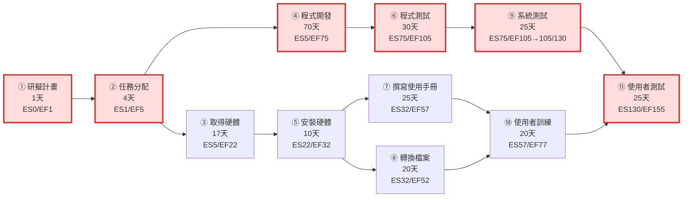
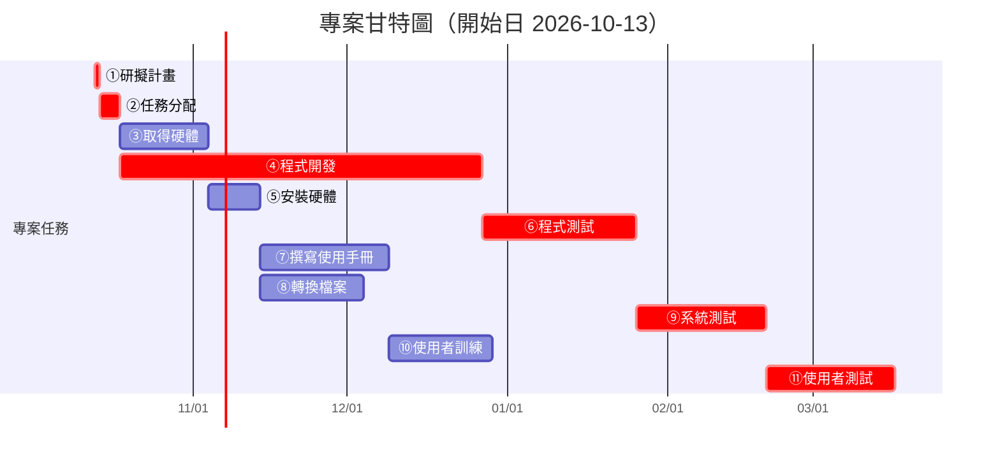

## 1. 任務清單

| 任務 | 說明 | 需時(天) | 前置任務 |
|:---:|---|:---:|:---:|
| 1 | 研擬計畫 | 1 | - |
| 2 | 任務分配 | 4 | 1 |
| 3 | 取得硬體 | 17 | 2 |
| 4 | 程式開發 | 70 | 2 |
| 5 | 安裝硬體 | 10 | 3 |
| 6 | 程式測試 | 30 | 4 |
| 7 | 撰寫使用手冊 | 25 | 5 |
| 8 | 轉換檔案 | 20 | 5 |
| 9 | 系統測試 | 25 | 6 |
| 10 | 使用者訓練 | 20 | 7, 8 |
| 11 | 使用者測試 | 25 | 9, 10 |

## 2. CPM 計算（最早/最晚開始與結束、寬裕時間）

| 任務 | ES | EF | LS | LF | 寬裕(Slack) | 是否關鍵 |
|:---:|:---:|:---:|:---:|:---:|:---:|:---:|
| 1 | 0 | 1 | 0 | 1 | 0 | ✅ |
| 2 | 1 | 5 | 1 | 5 | 0 | ✅ |
| 3 | 5 | 22 | 58 | 75 | 53 | |
| 4 | 5 | 75 | 5 | 75 | 0 | ✅ |
| 5 | 22 | 32 | 75 | 85 | 53 | |
| 6 | 75 | 105 | 75 | 105 | 0 | ✅ |
| 7 | 32 | 57 | 85 | 110 | 53 | |
| 8 | 32 | 52 | 90 | 110 | 58 | |
| 9 | 105 | 130 | 105 | 130 | 0 | ✅ |
| 10 | 57 | 77 | 110 | 130 | 53 | |
| 11 | 130 | 155 | 130 | 155 | 0 | ✅ |

**專案總工期：155 天**

## 3. 關鍵路徑

> **任務 1 → 2 → 4 → 6 → 9 → 11**
> （研擬計畫 → 任務分配 → 程式開發 → 程式測試 → 系統測試 → 使用者測試）
> 總長度 = 1 + 4 + 70 + 30 + 25 + 25 = **155 天**，寬裕時間皆為 0，為整個專案決定完工時程的路徑。

## 4. PERT/CPM 網路圖（Activity-on-Node）

## 5. 甘特圖（含開始 / 結束時間）

## 6. 各任務實際開始/結束日期

| 任務 | 開始日 | 結束日 |
|:---:|:---:|:---:|
| 1 研擬計畫 | 2026-10-13 | 2026-10-14 |
| 2 任務分配 | 2026-10-14 | 2026-10-18 |
| 3 取得硬體 | 2026-10-18 | 2026-11-04 |
| 4 程式開發 | 2026-10-18 | 2026-12-27 |
| 5 安裝硬體 | 2026-11-04 | 2026-11-14 |
| 6 程式測試 | 2026-12-27 | 2027-01-26 |
| 7 撰寫使用手冊 | 2026-11-14 | 2026-12-09 |
| 8 轉換檔案 | 2026-11-14 | 2026-12-04 |
| 9 系統測試 | 2027-01-26 | 2027-02-20 |
| 10 使用者訓練 | 2026-12-09 | 2026-12-29 |
| 11 使用者測試 | 2027-02-20 | 2027-03-17 |
